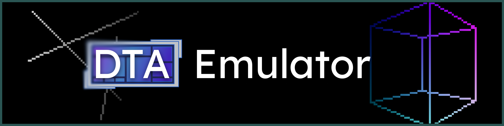

# DTA Emulator
This project is an emulator for a simple DTA architecture processor made from scratch in java. 

> ### **To Stardance voters:**  
> This application has been built for **Windows only**, as I do not have any other operating systems, and the GUI has been optimised for 1080p screens only.  
> Also, you need Java 18+ JDK installed in order for this to work, since the program is in the form of a jar.  
> If the application does not work properly, or the UI is scuffed, please skip the project.

## Usage
Download the release zip from the releases tab on github, unzip it and run DTA-Emulator.jar. Make sure the ``assets`` folder is in the same working directory as the program.

Alternatively, clone the Github repo and build it yourself with **main class EmulatorGUI.**

### **Follow the tutorial in HowToRunPrograms.md (in the source directory or from https://github.com/koino2/DTA-Emulator/blob/master/HowToRunPrograms.md) to start using the processor!**

## ISA / CPU Architecture
The project emulates a DTA (Data Transfer Architecture) processor, which is a minimal, 3 instruction ISA.  

The full documentation can be read at https://github.com/koino2/DTA-CPU/blob/master/spec-1/DTA.md

## GUI
The GUI features interfaces for controlling and viewing the processor. It has controls for every register, pin, device and component. It also allows you to develop applications with the assembler and start running them.

### Attributions
#### FlatLaf
The FlatLaf look and feel was used for the GUI theme.  
License can be found at ``licenses/flatlaf_license.txt`` (sourced from https://github.com/JFormDesigner/FlatLaf/blob/main/LICENSE)
